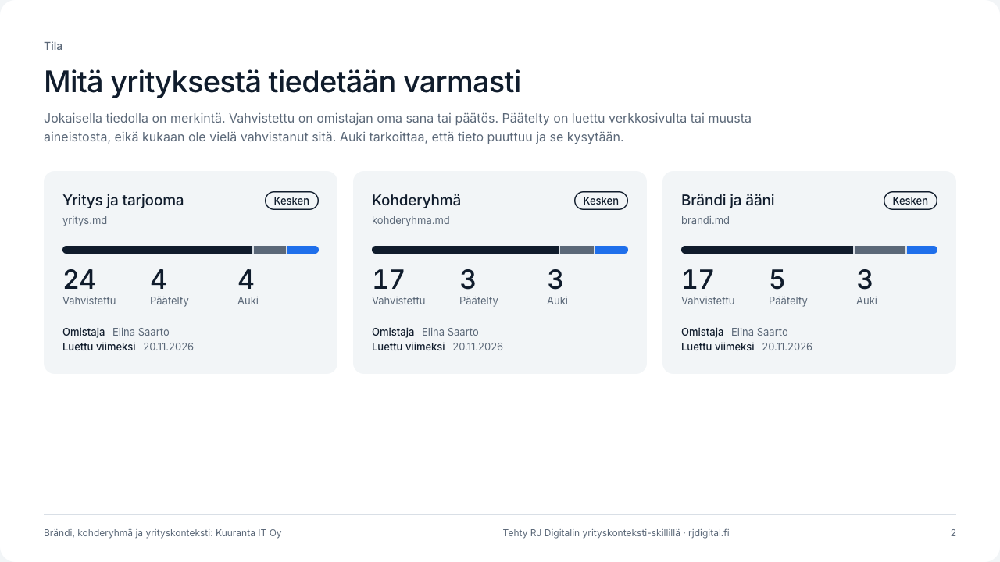
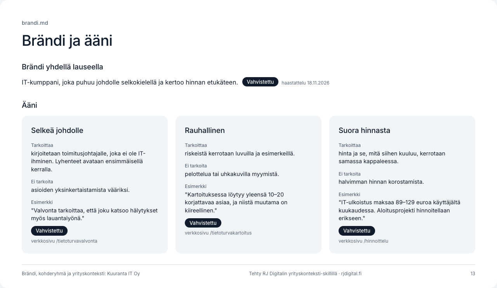
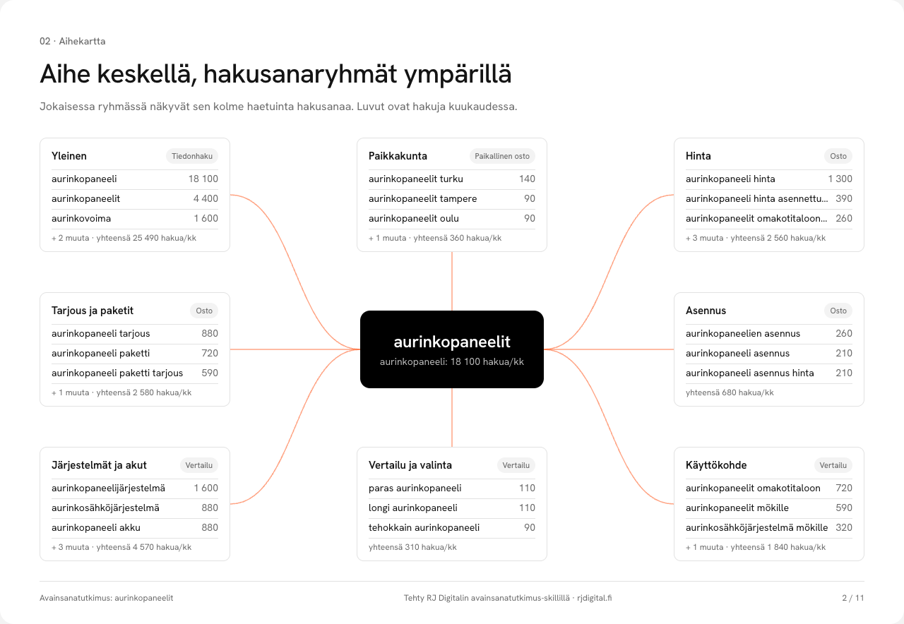
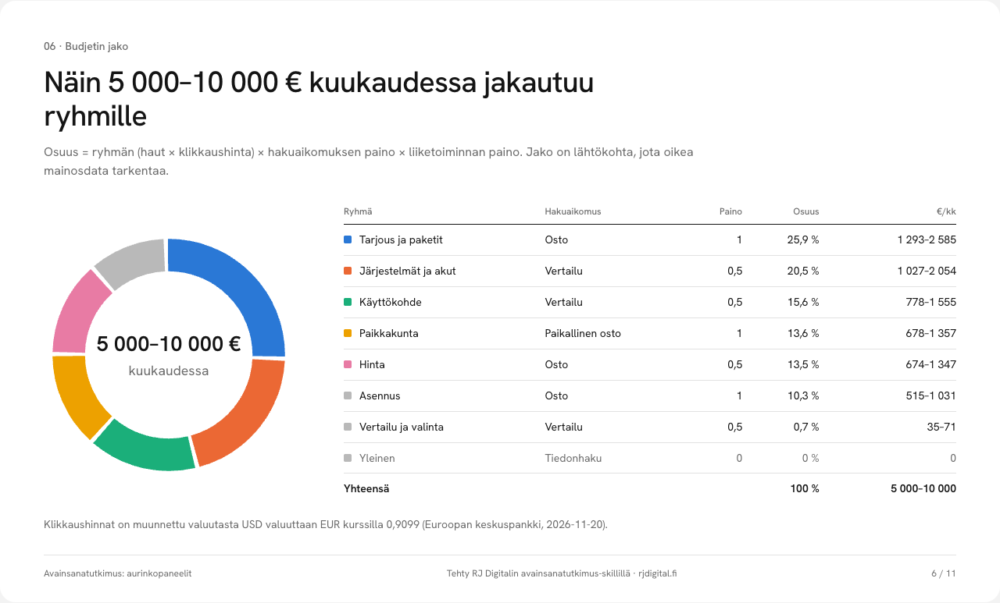

# RJ Digital skills

Free marketing skills for Finnish service companies. They work in Claude Code and other AI agents that read skills. A skill is a set of instructions an agent follows to do a job step by step.

Suomeksi: [README.md](README.md)

[](examples/yrityskonteksti/)

Above is a slide from the example report of the company context skill. Every skill returns its result as slides like this, and the examples are in the folder [examples](examples/).

## Start here

There are three skills, and each one runs on its own. If you only need a keyword research, do only that.

If you are starting from nothing, do the [company context](#brändi-kohderyhmä-ja-yrityskonteksti-brand-target-group-and-company-context) first. It is free and needs no API keys or paid data. The agent reads your website and writes a first draft in a few minutes. After that the other skills know what you sell and to whom, and do not ask the same things again.

| Order | Skill | What it needs |
| --- | --- | --- |
| 1 | [Yrityskonteksti (company context)](#brändi-kohderyhmä-ja-yrityskonteksti-brand-target-group-and-company-context) | your website address |
| 2 | [Avainsanatutkimus (keyword research)](#avainsanatutkimus-keyword-research) | a source of search data: your own SEO tool, a CSV export or DataForSEO |
| 3 | [Tekoälynäkyvyys (AI visibility check)](#tekoälynäkyvyys-ai-visibility-check) | a source of AI answers, for example DataForSEO (about $0.004 per answer) |

Every skill first looks at what kind of company you are and fits the work to it: [fit to your own situation](#fit-to-your-own-situation).

## Install

In Claude Code:

```
/plugin marketplace add rjdigital-fi/markkinointi-skillit
/plugin install rjdigital@rjdigital-fi
```

Or without the plugin: copy the folder of the skill you want, for example `skills/yrityskonteksti`, into your `~/.claude/skills/`.

The scripts need Node.js 18 or newer and nothing else.

## Brändi, kohderyhmä ja yrityskonteksti (brand, target group and company context)

Writes down the basics of a business in three plain files that an AI reads before it does anything else: what the company sells and at what price, who it sells to and who it does not, and how it sounds and looks. After that you do not explain the same things again in every conversation. It is made for Finnish companies and works in other languages too: file names and headings are in Finnish by default and in English when you work in English.

The agent first reads your website and your own texts, and asks you only what they do not answer. Every fact gets a marker:

- **confirmed**: the owner's own word or decision
- **derived**: read from the website or other material, not confirmed by anyone yet
- **open**: missing. The item stays empty and becomes a question. Nothing is filled in by guessing.

The result:

| File | Content |
| --- | --- |
| `tilanne.md` / `situation.md` | what kind of company this is and how the work is fitted to it: who uses the skill, how a sale happens, market, advertising and the tools in use |
| `yritys.md` / `company.md` | what is sold, to whom, at what price, why customers buy, what you do not promise or do |
| `kohderyhma.md` / `audience.md` | who you do not sell to, customer groups, the customer's own words, best and worst customers |
| `brandi.md` / `brand.md` | voice rules with real example sentences, vocabulary, form of address, how colours, font and logo are used |
| `kuvataulu.html` / `image-board.html` | the image board: the agent collects your pictures from the website or a folder, you answer with numbers which ones look like you and which are not used, and the picture rule is written from your choices |
| `brand.json` | name, logo, font and colours in a form the other skills read |
| `report.html` | the same as slides in the company's own colours, for the owner to read and approve |

Two slides from the example (in Finnish); the whole example with its files is in [examples/yrityskonteksti](examples/yrityskonteksti/).

[](examples/yrityskonteksti/)

[](examples/yrityskonteksti/)

The company, prices, numbers and customer sentences in the example are made up.

### Where the facts are read from

| Source | How |
| --- | --- |
| Website | A script reads the front page, up to seven key pages and the stylesheets. Public pages only, without logging in. |
| Own texts (optional) | Newsletters, offers, posts or emails as files. A script counts sentence length, form of address and common openings. |
| LinkedIn (optional) | Only from material you hand over: LinkedIn's own data export (`Shares.csv`), a profile saved as PDF, pasted text or direct links to single posts. The agent does not open LinkedIn in your logged-in browser. |
| You | An interview in batches of 3 to 5 questions. Dictated answers are fine, the agent sorts them. |

Nothing is sent to other services, and the skill needs no paid data.

### Use

```
Write the company context for Example Ltd, example.com. I approve the files.
```

Or call it directly: `/rjdigital:yrityskonteksti`. Install as above; the folder is `skills/yrityskonteksti`.

The files are saved in `yrityskonteksti/`. The first draft comes from the website in a few minutes, and most of it is still derived or open. The interview is what makes the files useful.

### Good to know

- The files are plain text. Git is not required: the folder can live on a shared drive.
- A fact read from the website is derived until the owner says it still holds. Websites go out of date.
- A voice rule needs a real sentence you have written yourselves. The agent does not invent examples or customer quotes.
- `check.mjs` checks the format of the files and reminds when the owner has not read a file for 180 days.
- The other skills read the folder first: keyword research and the AI visibility check do not ask again what the files already answer, and their reports get the same look.
- The look of the report comes from your own `brand.json`. The footer text can be changed or left empty in the same file.

### Where the ideas come from

Keeping the basics of a business in files that an AI reads before the work is an idea from the open [marketingskills](https://github.com/coreyhaines31/marketingskills) collection. What is my own here: the markers confirmed, derived and open, the check of the files, the owner and review date, and the report in the company's own colours. The code and the texts are my own.

## Avainsanatutkimus (keyword research)

Runs a keyword research for one topic with real data and returns a report you can act on: which pages to build and where an ad budget should go. It is made for the Finnish market and works in other languages and markets too. The agent answers in your language, and the report is written in Finnish or English.

The report holds:

- a topic map of the branches of the topic
- keywords in groups with search volume, click price, competition and search intent
- twelve months of seasonality for the main keyword
- a suggested budget split between the groups, in euros and for the budget range you give
- what AI assistants answer to a buyer's questions, which searches they run and which sources they use
- what the Google result page shows: AI Overview, People also ask and the top results
- where your own site stands, if you give Search Console or Bing Webmaster Tools data: the groups where the site already shows up, the groups where it does not, and the keywords at positions 5 to 15

The method is the one in the guide [Avainsanatutkimus](https://rjdigital.fi/oppaat/avainsanatutkimus) (in Finnish). 

The report comes as slides in one HTML file. Below are two slides from the example report (in Finnish); the whole example is in [examples/aurinkopaneelit](examples/aurinkopaneelit/).

[](examples/aurinkopaneelit/)

[](examples/aurinkopaneelit/)

The search data in the example is real, but the company, the budget and the weights are made up.

### Bring your own data source

The skill is not tied to one tool. The agent looks at what you have connected, tells you what each source covers and asks which to use. Sources can be mixed, for example volumes from Semrush and AI answers from Cloro.

| Source | What it gives | How to connect |
| --- | --- | --- |
| SEO tools: Semrush, Ahrefs, SE Ranking, Moz, Mangools, Ubersuggest, Serpstat, SISTRIX, Keywords Everywhere | keywords, volumes, click prices | the tool's MCP, API or a CSV export |
| DataForSEO | every part of the report | API login or MCP, a ready script is included |
| Ad platforms: Google Keyword Planner, Google Ads API, Microsoft Advertising | keywords, volumes, bid range or suggested bid | CSV export, API or MCP |
| Result page APIs: SearchApi, SerpApi, HasData, Serper, Bright Data | Google result pages and Google's AI answers | MCP or API |
| AI visibility tools: Cloro, Peec AI, Profound, Otterly, LLM Pulse, Nightwatch and others | answers from AI assistants with sources and the brands named | MCP, API or an export |
| Your site's own data: Google Search Console, Bing Webmaster Tools (optional) | the keywords the site already shows up for, at which position and with which page | MCP, API or a CSV export |
| Anything else | whatever the tool returns | the agent reads the tool's description and maps the fields |

Only keywords and volumes are required. Parts no source covers are left out of the report, and the agent says so.

Search Console and Bing Webmaster Tools are optional. The agent asks about them at the start. Their numbers are the site's own, so they are kept apart from market search volumes and shown in their own section of the report.

What has been tested: DataForSEO end to end with a real run in November 2026. The import for the other tools is tested with sample files built from each tool's column and field names. The tests are included: `node tests/run.mjs`. The Search Console and Bing Webmaster Tools import is tested the same way with sample files. Not every tool has been run with a real account, and tools change their exports, so the import always prints which fields it found and which it did not. Excel files are not read: export CSV. Please open an [issue](https://github.com/rjdigital-fi/markkinointi-skillit/issues) if something does not work.

### Use

```
Do a keyword research for solar panels. We install panels on houses in Tampere and Turku. The budget is 5,000–10,000 euros a month.
```

Or call it directly: `/rjdigital:avainsanatutkimus`. Install as above; the folder is `skills/avainsanatutkimus`.

The result is saved in `avainsanatutkimus/<topic>/`: `report.html` is the report as slides (opens in a browser and prints to PDF), `report.md` the same report as text and `keywords.csv` the full keyword list for a spreadsheet.

### Good to know

- Search volumes are estimates by the source. Tools give different numbers for the same keyword, so compare numbers within one source.
- Paid sources use credits or money. The agent gives an estimate before the first call and the real cost at the end. The calls for the example report cost about 0.15 US dollars in DataForSEO.
- API keys stay in environment variables or in the MCP connection. They are not written into the chat or into files.
- The budget split is a starting point from volume, click price and intent. Real campaign data replaces it after the first weeks.
- The agent first checks whether Google advertising is running, when it can see that from its own context or a connected Google Ads account. Otherwise it asks whether you spend money on Google advertising. If you do or plan to, it asks for a preliminary budget range. If not, the report is built without a budget. The report is in euros: when the source gives click prices in US dollars, they are converted with the European Central Bank's reference rate, and the rate and its date are shown in the report.

## Tekoälynäkyvyys (AI visibility check)

Finds out whether AI assistants name your company when a buyer asks for a recommendation. The agent asks the buyer's questions from ChatGPT, Gemini, Google AI Mode and, if you want, Perplexity, reads the answers and builds a report. It is made for the Finnish market and works in other languages and markets too, and the report is written in Finnish or English.

The report holds:

- a question by AI table: in which answers the company is named and where its own site is a source
- visibility per AI
- the companies the AI names for the same questions
- the sites the answers lean on
- quotes of what was said about the company
- where the result comes from: a rough check of three areas of work, the technical base, the content and mentions elsewhere. The agent reads the homepage, robots.txt and sitemap of your site and up to ten source pages of the answers. The check is free and indicative.
- the method: questions, runs and the limits of the result

Two slides from the example report (in Finnish); the whole example is in [examples/ilmalampopumput](examples/ilmalampopumput/).

[](examples/ilmalampopumput/)

[](examples/ilmalampopumput/)

The companies, sites and answers in the example are made up.

A quick three-question version runs in the browser: [tekoälynäkyvyyden testi](https://rjdigital.fi/tekoalynakyvyys-testi) (in Finnish).

### Data source

What matters is that the answers come from the real apps with web search on, with sources.

| Source | How to connect |
| --- | --- |
| DataForSEO | API login in environment variables, a ready script is included. About 0.004 US dollars per answer (Perplexity about 0.007). |
| AI visibility tools: Cloro, Peec AI, Profound, Otterly and others | MCP, API or an export. Answers are brought in with `answers.mjs`. |
| Result page APIs: SerpApi, SearchApi, HasData | Google AI Mode and AI Overviews, brought in with the same script |
| Anything else | the answer as a JSON or text file, the agent maps the fields |

What has been tested: DataForSEO with a real run in November 2026 (ChatGPT, Gemini and AI Mode). The import for other tools is tested with sample files, not with real accounts. The import always prints what it found.

### Use

```
Check the AI visibility of Example Ltd, example.com. We install heat pumps in houses around Tampere.
```

Or call it directly: `/rjdigital:tekoalynakyvyys`. Install as above; the folder is `skills/tekoalynakyvyys`.

The agent proposes the questions and you edit them to sound like your customers. It tells the cost before fetching. The result is saved in `tekoalynakyvyys/<company>/`.

### Good to know

- The result is a snapshot. An AI answers the same question differently each time, so every question is asked 2 to 3 times. With a small question set, a change under about 10 percentage points is noise.
- Keep the questions the same if you want to compare later. New questions are a new baseline.
- Questions are sent to the AIs without the company's name.
- "Named" means the company's name is in the answer text. "Cited" means the AI used the company's site as a source. They are counted separately.
- A script collects company names from the answers, and the agent reads the answers and confirms which of them are competitors.

### Credits

The method borrows ideas from open projects: a question set that follows the buying path, repeated runs and the caution about small changes ([geo-visibility-skill](https://github.com/thevibegarage/geo-visibility-skill)), telling a mention from a bare source link ([oneglanse](https://github.com/oneglanse/oneglanse)) and two-stage name detection ([elmo](https://github.com/elmohq/elmo)). The code is my own.

## Fit to your own situation

The skills are made for Finnish service companies. Service companies still differ a lot: an installer with one town, a chain with twenty locations, a B2B firm where a sale takes months, or an agency doing the work for its clients.

So every skill starts with the same step. The agent looks at what it already knows about your company: its own instruction files (for example `CLAUDE.md`), its memory, the documents in the project and the connected tools. It tells you in a few lines how it understood your situation and what it changes because of it. You correct what is wrong. The result is saved in `yrityskonteksti/tilanne.md`, so you are asked only once. Example (in Finnish): [tilanne.md](examples/yrityskonteksti/tilanne.md).

Examples of what changes:

- **Chain:** town is its own branch in the keyword research, and AI visibility is checked for up to three towns first.
- **B2B firm:** the questions to the AIs are written by the buyer's role, and the report reminds that a small search volume is not the same as small demand.
- **Agency:** every client has its own folder and its own files.

The fit changes questions, vocabulary and emphasis. It does not change the rule that every number comes from the data and nothing is filled in by guessing.

You can also ask for the fit alone, before doing anything else:

```
Read the RJ Digital skills and tell me how you would fit them to our company.
```

## Make it look like yours

You can restyle every tool and report to your own brand: your own theme, fonts and colours. In every skill the look lives in one file, `brand.json` (for example `skills/avainsanatutkimus/brand.json`): name, logo, font and colours. A `brand.json` copied to the work folder overrides the skill's own, so each client can have a different look. Ask the agent to change the look, for example by giving it your website address, and it will do it for you. If you have made the company context, the other skills take the look from its `brand.json`.

The AI visibility report shows the icons of companies, source sites and AIs. They load from Google's favicon service when the report is opened. `"icons": false` turns them off.

## Author

Joonas Rotko, [RJ Digital](https://rjdigital.fi).

## License

MIT.
