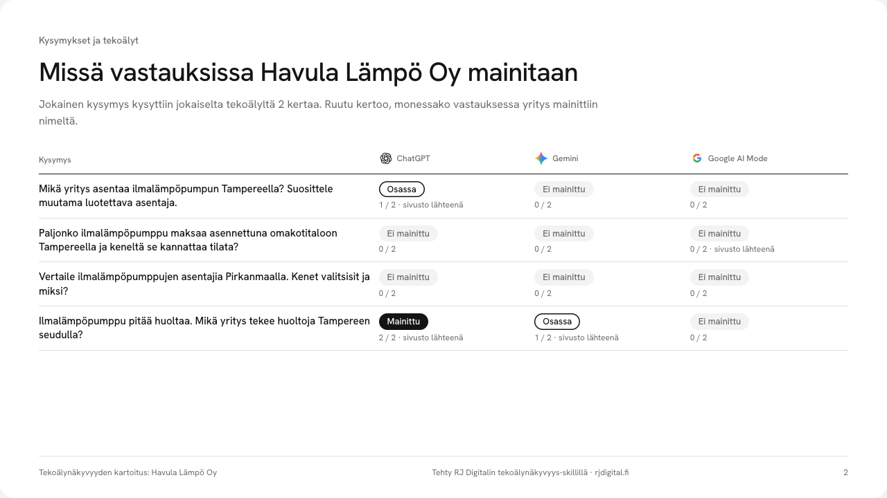
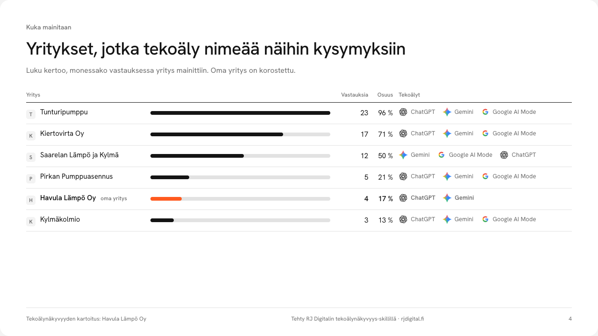

# RJ Digital skills

Free skills for Claude Code and other AI agents that read skills. A skill is a set of instructions an agent follows to do a job step by step.

Suomeksi: [README.md](README.md)

## Avainsanatutkimus (keyword research)

Runs a keyword research for one topic with real data and returns a report you can act on: which pages to build and where an ad budget should go. It works in any language and market. The agent answers in your language, and the report is written in Finnish or English.

The report holds:

- a topic map of the branches of the topic
- keywords in groups with search volume, click price, competition and search intent
- twelve months of seasonality for the main keyword
- a suggested budget split between the groups, in euros and for the budget range you give
- what AI assistants answer to a buyer's questions, which searches they run and which sources they use
- what the Google result page shows: AI Overview, People also ask and the top results
- where your own site stands, if you give Search Console or Bing Webmaster Tools data: the groups where the site already shows up, the groups where it does not, and the keywords at positions 5 to 15

The method is the one in the guide [Avainsanatutkimus](https://rjdigital.fi/oppaat/avainsanatutkimus) (in Finnish). 

The report comes as slides in one HTML file. Below are two slides from the example report (in Finnish); the whole example is in [examples/aurinkopaneelit](examples/aurinkopaneelit/).

[](examples/aurinkopaneelit/)

[](examples/aurinkopaneelit/)

The search data in the example is real, but the company, the budget and the weights are made up.

### Bring your own data source

The skill is not tied to one tool. The agent looks at what you have connected, tells you what each source covers and asks which to use. Sources can be mixed, for example volumes from Semrush and AI answers from Cloro.

| Source | What it gives | How to connect |
| --- | --- | --- |
| SEO tools: Semrush, Ahrefs, SE Ranking, Moz, Mangools, Ubersuggest, Serpstat, SISTRIX, Keywords Everywhere | keywords, volumes, click prices | the tool's MCP, API or a CSV export |
| DataForSEO | every part of the report | API login or MCP, a ready script is included |
| Ad platforms: Google Keyword Planner, Google Ads API, Microsoft Advertising | keywords, volumes, bid range or suggested bid | CSV export, API or MCP |
| Result page APIs: SearchApi, SerpApi, HasData, Serper, Bright Data | Google result pages and Google's AI answers | MCP or API |
| AI visibility tools: Cloro, Peec AI, Profound, Otterly, LLM Pulse, Nightwatch and others | answers from AI assistants with sources and the brands named | MCP, API or an export |
| Your site's own data: Google Search Console, Bing Webmaster Tools (optional) | the keywords the site already shows up for, at which position and with which page | MCP, API or a CSV export |
| Anything else | whatever the tool returns | the agent reads the tool's description and maps the fields |

Only keywords and volumes are required. Parts no source covers are left out of the report, and the agent says so.

Search Console and Bing Webmaster Tools are optional. The agent asks about them at the start. Their numbers are the site's own, so they are kept apart from market search volumes and shown in their own section of the report.

What has been tested: DataForSEO end to end with a real run in November 2026. The import for the other tools is tested with sample files built from each tool's column and field names. The tests are included: `node tests/run.mjs`. The Search Console and Bing Webmaster Tools import is tested the same way with sample files. Not every tool has been run with a real account, and tools change their exports, so the import always prints which fields it found and which it did not. Excel files are not read: export CSV. Please open an [issue](https://github.com/rjdigital-fi/skills/issues) if something does not work.

### Install

In Claude Code:

```
/plugin marketplace add rjdigital-fi/skills
/plugin install rjdigital@rjdigital-fi
```

Or without the plugin: copy the folder `skills/avainsanatutkimus` into your `~/.claude/skills/`.

The scripts need Node.js 18 or newer and nothing else.

### Use

```
Do a keyword research for solar panels. We install panels on houses in Tampere and Turku. The budget is 1,000–2,000 euros a month.
```

Or call it directly: `/rjdigital:avainsanatutkimus`.

The result is saved in `avainsanatutkimus/<topic>/`: `report.html` is the report as slides (opens in a browser and prints to PDF), `report.md` the same report as text and `keywords.csv` the full keyword list for a spreadsheet.

### Good to know

- Search volumes are estimates by the source. Tools give different numbers for the same keyword, so compare numbers within one source.
- Paid sources use credits or money. The agent gives an estimate before the first call and the real cost at the end. The calls for the example report cost about 0.15 US dollars in DataForSEO.
- API keys stay in environment variables or in the MCP connection. They are not written into the chat or into files.
- The budget split is a starting point from volume, click price and intent. Real campaign data replaces it after the first weeks.
- The agent always asks for a preliminary budget range. The report is in euros: when the source gives click prices in US dollars, they are converted with the European Central Bank's reference rate, and the rate and its date are shown in the report.

## Tekoälynäkyvyys (AI visibility check)

Finds out whether AI assistants name your company when a buyer asks for a recommendation. The agent asks the buyer's questions from ChatGPT, Gemini, Google AI Mode and, if you want, Perplexity, reads the answers and builds a report. It works in any language and market, and the report is written in Finnish or English.

The report holds:

- a question by AI table: in which answers the company is named and where its own site is a source
- visibility per AI
- the companies the AI names for the same questions
- the sites the answers lean on
- quotes of what was said about the company
- the method: questions, runs and the limits of the result

Two slides from the example report (in Finnish); the whole example is in [examples/ilmalampopumput](examples/ilmalampopumput/).

[](examples/ilmalampopumput/)

[](examples/ilmalampopumput/)

The companies, sites and answers in the example are made up.

A quick three-question version runs in the browser: [tekoälynäkyvyyden testi](https://rjdigital.fi/tekoalynakyvyys-testi) (in Finnish).

### Data source

What matters is that the answers come from the real apps with web search on, with sources.

| Source | How to connect |
| --- | --- |
| DataForSEO | API login in environment variables, a ready script is included. About 0.004 US dollars per answer (Perplexity about 0.007). |
| AI visibility tools: Cloro, Peec AI, Profound, Otterly and others | MCP, API or an export. Answers are brought in with `answers.mjs`. |
| Result page APIs: SerpApi, SearchApi, HasData | Google AI Mode and AI Overviews, brought in with the same script |
| Anything else | the answer as a JSON or text file, the agent maps the fields |

What has been tested: DataForSEO with a real run in November 2026 (ChatGPT, Gemini and AI Mode). The import for other tools is tested with sample files, not with real accounts. The import always prints what it found.

### Use

```
Check the AI visibility of Example Ltd, example.com. We install heat pumps in houses around Tampere.
```

Or call it directly: `/rjdigital:tekoalynakyvyys`. Install as above; the folder is `skills/tekoalynakyvyys`.

The agent proposes the questions and you edit them to sound like your customers. It tells the cost before fetching. The result is saved in `tekoalynakyvyys/<company>/`.

### Good to know

- The result is a snapshot. An AI answers the same question differently each time, so every question is asked 2 to 3 times. With a small question set, a change under about 10 percentage points is noise.
- Keep the questions the same if you want to compare later. New questions are a new baseline.
- Questions are sent to the AIs without the company's name.
- "Named" means the company's name is in the answer text. "Cited" means the AI used the company's site as a source. They are counted separately.
- A script collects company names from the answers, and the agent reads the answers and confirms which of them are competitors.

### Credits

The method borrows ideas from open projects: a question set that follows the buying path, repeated runs and the caution about small changes ([geo-visibility-skill](https://github.com/thevibegarage/geo-visibility-skill)), telling a mention from a bare source link ([oneglanse](https://github.com/oneglanse/oneglanse)) and two-stage name detection ([elmo](https://github.com/elmohq/elmo)). The code is my own.

## Make it look like yours

You can restyle every tool and report to your own brand: your own theme, fonts and colours. In both skills the look lives in one file, `brand.json` (`skills/avainsanatutkimus/brand.json` and `skills/tekoalynakyvyys/brand.json`): name, logo, font and colours. A `brand.json` copied to the work folder overrides the skill's own, so each client can have a different look. Ask the agent to change the look, for example by giving it your website address, and it will do it for you.

The AI visibility report shows the icons of companies, source sites and AIs. They load from Google's favicon service when the report is opened. `"icons": false` turns them off.

## Author

Joonas Rotko, [RJ Digital](https://rjdigital.fi).

## License

MIT.
