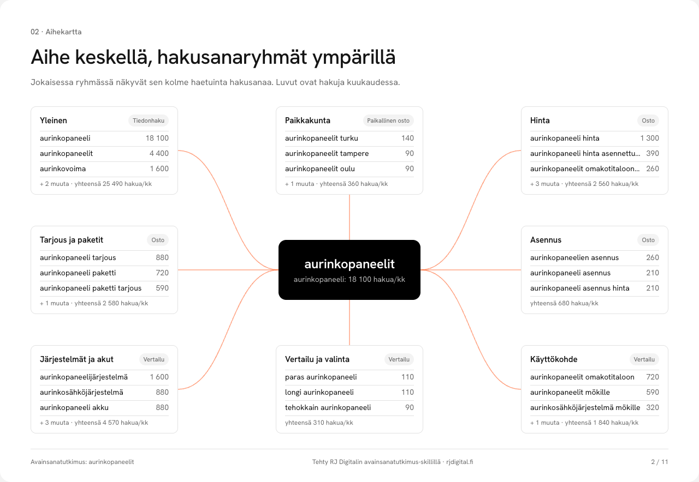
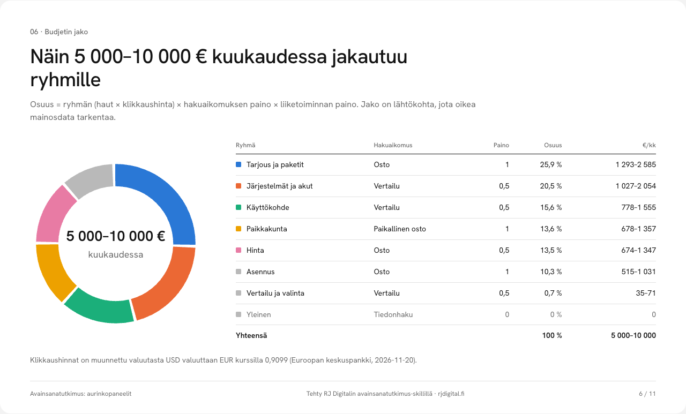
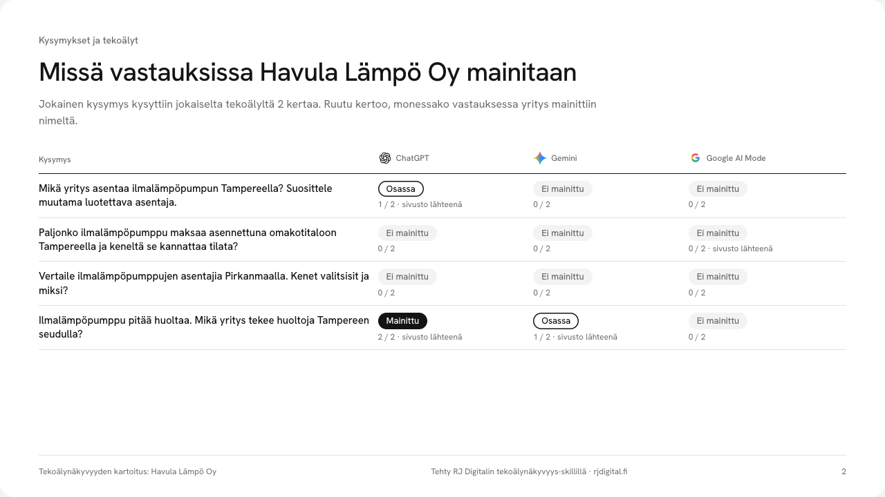
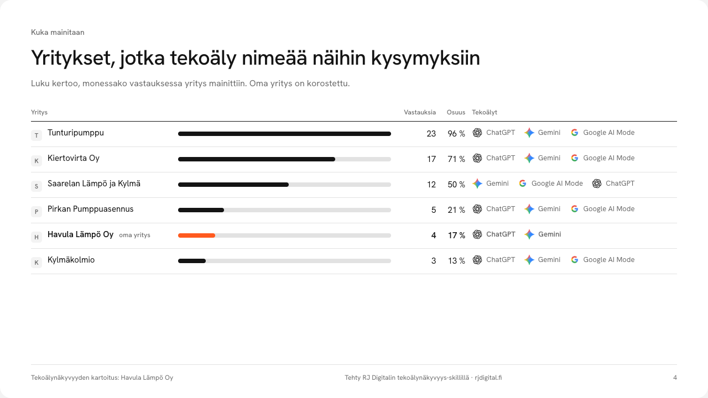
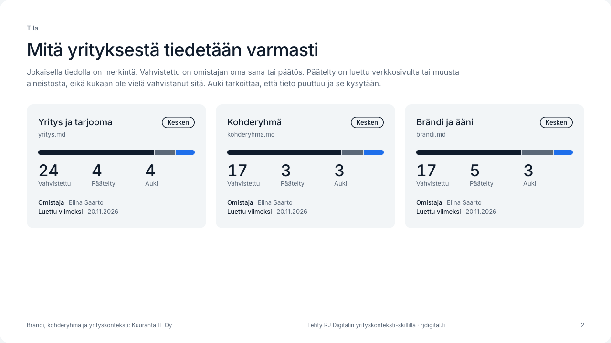
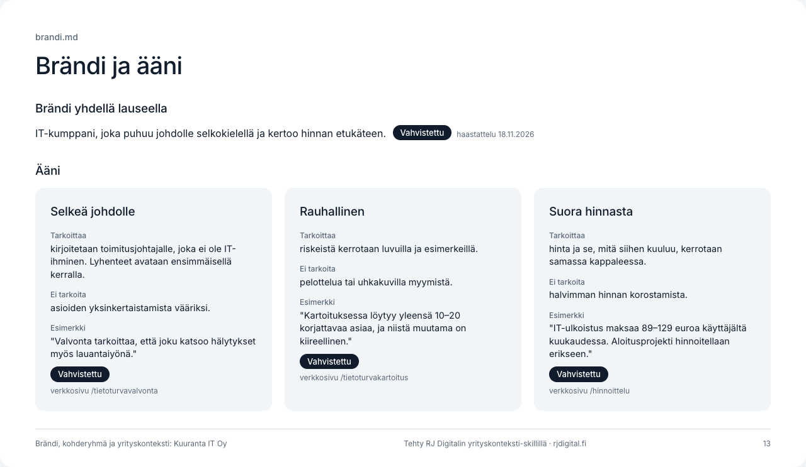
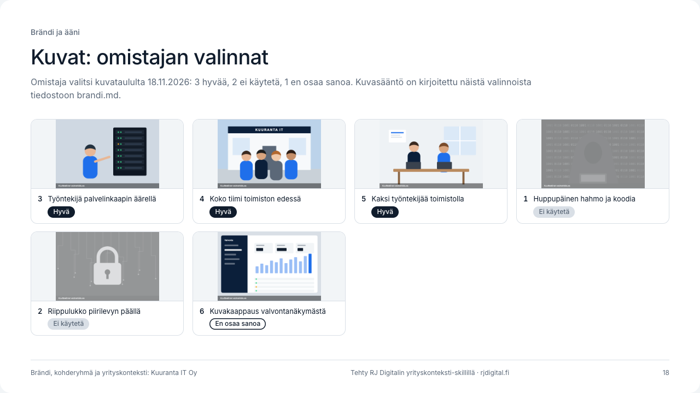

# RJ Digitalin skillit

Ilmaisia skillejä Claude Codeen ja muihin tekoälyagentteihin, jotka osaavat lukea skillejä. Skilli on ohje, jonka mukaan agentti tekee työn vaihe vaiheelta. Tein nämä omaan käyttööni ja jaan ne, koska samalla menetelmällä pääsee alkuun kuka tahansa.

In English: [README.en.md](README.en.md)

## Avainsanatutkimus

Skilli tekee avainsanatutkimuksen yhdestä aiheesta oikealla datalla ja palauttaa raportin, jonka pohjalta voitte päättää, mitä sivuja teette ja mihin mainosbudjetti kannattaa laittaa.

Raportissa on:

- aihekartta, josta näkee aiheen haarat yhdellä silmäyksellä
- hakusanat ryhmiteltyinä: hakumäärä, klikkaushinta, kilpailu ja hakuaikomus
- pääsanan kausivaihtelu 12 kuukaudelta
- ehdotus budjetin jaosta ryhmien kesken, euroina antamanne budjettihaarukan mukaan
- mitä tekoäly vastaa ostajan kysymyksiin, mitä hakuja se tekee ja mihin lähteisiin se nojaa
- mitä Googlen tulossivulla näkyy: tekoälykatsaus, "Muut kysyvät myös" ja kärkitulokset
- oman sivustonne tilanne, jos annatte Search Consolen tai Bing Webmaster Toolsin datan: missä ryhmissä sivusto jo näkyy, missä ei vielä ja mitkä hakusanat ovat sijoilla 5–15

Menetelmä on sama kuin oppaassani [Avainsanatutkimus](https://rjdigital.fi/oppaat/avainsanatutkimus).

Raportti tulee dioina yhtenä HTML-tiedostona. Alla on kaksi diaa esimerkkiraportista, koko esimerkki on kansiossa [examples/aurinkopaneelit](examples/aurinkopaneelit/).

[](examples/aurinkopaneelit/)

[](examples/aurinkopaneelit/)

Esimerkin hakudata on oikeaa, mutta yritys, budjetti ja painot ovat keksittyjä: kuvitteellinen esimerkki.

### Valitkaa datalähde itse

Skilli ei ole sidottu yhteen työkaluun. Käyttäkää sitä, mikä teillä on jo käytössä. Agentti katsoo alussa, mitä on kytketty, kertoo, mihin kukin lähde riittää, ja kysyy, mitä käytetään. Lähteitä voi yhdistää: hakumäärät esimerkiksi Semrushista ja tekoälyn vastaukset Clorosta. Excel-tiedostoja skilli ei lue, joten viekää tiedot CSV-muodossa.

| Lähde | Mitä siitä saa | Miten kytketään |
| --- | --- | --- |
| SEO-työkalut: Semrush, Ahrefs, SE Ranking, Moz, Mangools, Ubersuggest, Serpstat, SISTRIX, Keywords Everywhere | hakusanat, hakumäärät, klikkaushinnat | työkalun oma MCP, rajapinta tai CSV-vienti |
| DataForSEO | kaikki raportin osat | rajapinnan tunnukset tai MCP, mukana valmis skripti |
| Mainosalustat: Google Keyword Planner, Google Ads -rajapinta, Microsoft Advertising | hakusanat, hakumäärät, hintahaarukka tai hintaehdotus | CSV-vienti, rajapinta tai MCP |
| Tulossivurajapinnat: SearchApi, SerpApi, HasData, Serper, Bright Data | Googlen tulossivut ja Googlen tekoälyvastaukset | MCP tai rajapinta |
| Tekoälynäkyvyyden työkalut: Cloro, Peec AI, Profound, Otterly, LLM Pulse, Nightwatch ja muut | tekoälyjen vastaukset lähteineen ja mainittuine brändeineen | MCP, rajapinta tai vienti |
| Oman sivuston data: Google Search Console, Bing Webmaster Tools (valinnainen) | millä hakusanoilla sivusto jo näkyy, millä sijalla ja millä sivulla | MCP, rajapinta tai CSV-vienti |
| Jokin muu | sen mukaan, mitä työkalu antaa | agentti lukee työkalun kuvauksen ja sovittaa kentät |

Pakollisia ovat vain hakusanat ja hakumäärät. Jos lähteestä ei saa tekoälyn vastauksia tai tulossivuja, ne osat jäävät raportista pois ja agentti sanoo sen.

Search Console ja Bing Webmaster Tools ovat valinnaisia. Agentti kysyy niistä alussa. Niiden luvut ovat sivuston omia lukuja, joten ne pidetään erillään markkinan hakumääristä ja näytetään raportissa omassa osiossaan.

Mitä on testattu: DataForSEO kokonaan oikealla ajolla marraskuussa 2026. Muiden työkalujen tuonti on testattu mallitiedostoilla, jotka on rakennettu kunkin työkalun sarakkeiden ja kenttien nimillä. Testit ovat mukana, ja ne voi ajaa komennolla `node tests/run.mjs`. Search Consolen ja Bing Webmaster Toolsin tuonti on testattu samalla tavalla mallitiedostoilla. Jokaista työkalua en ole ajanut oikealla tilillä. Työkalut myös muuttavat vientejään, joten tuonti tulostaa aina, mitkä kentät se löysi ja mitkä jäivät löytymättä. Kertokaa [issuessa](https://github.com/rjdigital-fi/markkinointi-skillit/issues), jos jokin ei toimi.

### Asennus

Claude Codessa:

```
/plugin marketplace add rjdigital-fi/markkinointi-skillit
/plugin install rjdigital@rjdigital-fi
```

Tai ilman pluginia: kopioikaa kansio `skills/avainsanatutkimus` omaan `~/.claude/skills/`-kansioonne.

Skriptit tarvitsevat Node.js-version 18 tai uudemman. Muita asennuksia ei tarvita.

### Käyttö

Kirjoittakaa Claude Codessa esimerkiksi:

```
Tee avainsanatutkimus aiheesta aurinkopaneelit. Asennamme paneeleita omakotitaloihin Tampereella ja Turussa. Budjetti on 1 000–2 000 euroa kuukaudessa.
```

Tai kutsukaa suoraan: `/rjdigital:avainsanatutkimus`.

Agentti käy työn läpi vaiheittain: lähteen valinta, aihekartta, hakumäärät ja hinnat, ryhmittely ja hakuaikomus, tekoälyn kysymykset, oman sivuston tilanne ja lopuksi raportti. Se kysyy teiltä ne asiat, jotka vain te tiedätte: mitä myytte, mitä ette myy ja millä alueella.

Tulos tallentuu kansioon `avainsanatutkimus/<aihe>/`: `report.html` on raportti dioina (avautuu selaimessa ja tulostuu PDF:ksi), `report.md` sama raportti tekstinä ja `keywords.csv` koko hakusanalista taulukkolaskentaan.

### Hyvä tietää

- Hakumäärät ovat lähteen arvioita. Eri työkalut antavat samalle hakusanalle eri luvun, joten vertailkaa lukuja saman lähteen sisällä.
- Maksullisissa lähteissä haut kuluttavat krediittejä tai rahaa. Agentti kertoo arvion ennen ensimmäistä hakua ja toteutuneen kulun lopuksi. Esimerkkiraportin haut maksoivat DataForSEO:ssa yhteensä noin 0,15 dollaria.
- Rajapinnan avaimet pidetään ympäristömuuttujissa tai MCP-yhteydessä. Niitä ei kirjoiteta keskusteluun eikä tiedostoihin.
- Budjetin jako on lähtökohta, joka lasketaan hakumääristä, klikkaushinnoista ja hakuaikomuksesta. Oikea mainosdata tarkentaa sen ensimmäisten viikkojen jälkeen.
- Agentti kysyy aina alustavan budjettihaarukan. Raportti on euroissa: jos lähteen klikkaushinnat ovat dollareissa, ne muunnetaan Euroopan keskuspankin viitekurssilla, ja kurssi päivämäärineen näkyy raportissa.

## Tekoälynäkyvyys

Skilli selvittää, mainitseeko tekoäly yrityksenne, kun ostaja pyytää suositusta. Agentti kysyy ostajan kysymykset ChatGPT:ltä, Geminiltä, Googlen AI Modelta ja halutessanne Perplexityltä, lukee vastaukset ja tekee niistä raportin.

Raportissa on:

- taulukko kysymyksistä ja tekoälyistä: missä vastauksissa yrityksenne mainitaan ja missä oma sivustonne on lähteenä
- näkyvyys tekoälyittäin
- yritykset, jotka tekoäly nimeää samoihin kysymyksiin
- sivustot, joihin vastaukset nojaavat
- lainaukset siitä, mitä yrityksestänne sanottiin
- mistä tulos syntyy: pikatarkistus kolmesta työalueesta eli teknisestä pohjasta, sisällöstä ja maininnoista muualla. Agentti lukee sivustonne etusivun, robots.txt-tiedoston ja sivukartan sekä enintään kymmenen vastausten lähdesivua. Tarkistus on ilmainen ja suuntaa antava.
- menetelmä: kysymykset, ajokerrat ja tuloksen rajat

Alla on kaksi diaa esimerkkiraportista, koko esimerkki on kansiossa [examples/ilmalampopumput](examples/ilmalampopumput/).

[](examples/ilmalampopumput/)

[](examples/ilmalampopumput/)

Esimerkin yritykset, sivustot ja vastaukset ovat keksittyjä: kuvitteellinen esimerkki.

Nopean kolmen kysymyksen version voi kokeilla selaimessa: [tekoälynäkyvyyden testi](https://rjdigital.fi/tekoalynakyvyys-testi). Skilli on sama asia laajempana: kysymyksiä on niin monta kuin tarvitaan, ja jokainen kysytään useaan kertaan.

### Datalähde

Tärkeintä on, että vastaukset tulevat oikeista sovelluksista verkkohaku päällä ja lähteet mukana.

| Lähde | Miten kytketään |
| --- | --- |
| DataForSEO | rajapinnan tunnukset ympäristömuuttujissa, mukana valmis skripti. Yksi vastaus maksaa noin 0,004 dollaria (Perplexity noin 0,007). |
| Tekoälynäkyvyyden työkalut: Cloro, Peec AI, Profound, Otterly ja muut | MCP, rajapinta tai vienti. Vastaukset tuodaan skriptillä `answers.mjs`. |
| Tulossivurajapinnat: SerpApi, SearchApi, HasData | Googlen AI Mode ja tekoälykatsaukset, tuodaan samalla skriptillä |
| Jokin muu | vastaus JSON- tai tekstitiedostona, agentti sovittaa kentät |

Mitä on testattu: DataForSEO oikealla ajolla marraskuussa 2026 (ChatGPT, Gemini ja AI Mode). Muiden työkalujen tuonti on testattu mallitiedostoilla, ei oikeilla tileillä. Tuonti tulostaa aina, mitä se löysi.

### Käyttö

```
Kartoita tekoälynäkyvyys yritykselle Esimerkki Oy, esimerkki.fi. Asennamme ilmalämpöpumppuja omakotitaloihin Tampereen seudulla.
```

Tai kutsukaa suoraan: `/rjdigital:tekoalynakyvyys`. Asennus on sama kuin yllä, kansio on `skills/tekoalynakyvyys`.

Agentti ehdottaa kysymykset, ja te muokkaatte ne sellaisiksi, kuin asiakkaanne ne kirjoittaisi. Ennen hakua agentti kertoo hinnan. Tulos tallentuu kansioon `tekoalynakyvyys/<yritys>/`.

### Hyvä tietää

- Tulos on tilannekuva. Tekoäly vastaa samaan kysymykseen eri kerroilla eri tavalla, joten jokainen kysymys kysytään 2–3 kertaa. Pienellä kysymysmäärällä alle noin 10 prosenttiyksikön muutos on satunnaisvaihtelua.
- Pitäkää kysymykset samoina, jos haluatte verrata tulosta myöhemmin. Uudet kysymykset ovat uusi lähtötaso.
- Kysymykset lähetetään tekoälyille ilman yrityksen nimeä.
- "Mainittu" tarkoittaa, että yrityksen nimi on vastauksen tekstissä. "Lähteenä" tarkoittaa, että tekoäly nojasi yrityksen sivustoon. Ne lasketaan erikseen.
- Skripti poimii vastauksista yritysten nimiä, ja agentti lukee vastaukset ja varmistaa, mitkä nimistä ovat oikeasti kilpailijoita.

### Kiitokset

Menetelmässä on ideoita avoimista projekteista: ostopolun mukainen kysymysjoukko, toistetut ajot ja varoitus pienistä muutoksista ([geo-visibility-skill](https://github.com/thevibegarage/geo-visibility-skill)), maininnan ja pelkän lähdelinkin erottaminen ([oneglanse](https://github.com/oneglanse/oneglanse)) ja kaksivaiheinen nimien tunnistus ([elmo](https://github.com/elmohq/elmo)). Koodi on omaa.

## Brändi, kohderyhmä ja yrityskonteksti

Skilli kirjoittaa yrityksen perustiedot kolmeen tekstitiedostoon, jotka tekoäly lukee ennen kuin se tekee mitään muuta: mitä yritys myy ja mihin hintaan, kenelle se myy ja kenelle ei, ja miltä se kuulostaa ja näyttää. Sen jälkeen samoja asioita ei tarvitse selittää jokaisessa keskustelussa uudelleen.

Agentti lukee ensin verkkosivunne ja omat tekstinne ja kysyy teiltä vain sen, mitä niistä ei selviä. Jokainen tieto saa merkinnän:

- **vahvistettu**: omistajan oma sana tai päätös
- **päätelty**: luettu verkkosivulta tai muusta aineistosta, eikä kukaan ole vielä vahvistanut sitä
- **auki**: tieto puuttuu. Kohta jää tyhjäksi ja se kysytään. Mitään ei täytetä arvaamalla.

Tulos:

| Tiedosto | Sisältö |
| --- | --- |
| `yritys.md` | mitä myydään, kenelle, mihin hintaan, miksi teiltä ostetaan, mitä ette lupaa ettekä tee |
| `kohderyhma.md` | kenelle ette myy, asiakasryhmät, asiakkaan omat sanat, parhaat ja huonoimmat asiakkaat |
| `brandi.md` | äänen säännöt oikeine esimerkkilauseineen, sanasto, puhuttelu, värien, fontin ja logon käyttö |
| `kuvataulu.html` | kuvataulu: agentti kerää kuvanne verkkosivulta tai kansiosta, te vastaatte numeroilla, mitkä ovat teidän näköisiänne ja mitä ei käytetä, ja kuvasääntö kirjoitetaan valinnoistanne |
| `brand.json` | nimi, logo, fontti ja värit muodossa, jonka muut skillit lukevat |
| `report.html` | sama diaesityksenä yrityksenne omissa väreissä, omistajan luettavaksi ja hyväksyttäväksi |

Alla on kolme diaa esimerkistä, koko esimerkki tiedostoineen on kansiossa [examples/yrityskonteksti](examples/yrityskonteksti/).

[](examples/yrityskonteksti/)

[](examples/yrityskonteksti/)

[](examples/yrityskonteksti/)

Esimerkin yritys, hinnat, luvut ja asiakkaiden lauseet ovat keksittyjä: kuvitteellinen esimerkki.

### Mistä tiedot luetaan

| Lähde | Miten |
| --- | --- |
| Verkkosivu | Skripti lukee etusivun, enintään seitsemän tärkeintä sivua ja tyylitiedostot. Vain julkiset sivut, ilman kirjautumista. |
| Omat tekstit (vapaaehtoinen) | Uutiskirjeet, tarjoukset, julkaisut tai sähköpostit tiedostoina. Skripti laskee niistä lauseiden pituuden, puhuttelun ja tavalliset aloitukset. |
| LinkedIn (vapaaehtoinen) | Vain aineistosta, jonka annatte itse: LinkedInin oma datavienti (`Shares.csv`), profiili PDF:nä, liitetty teksti tai suorat linkit yksittäisiin julkaisuihin. Agentti ei avaa LinkedIniä kirjautuneella selaimellanne. |
| Te itse | Haastattelu 3–5 kysymyksen erissä. Vastaukset saa sanella, agentti järjestää ne. |

Mitään ei lähetetä muihin palveluihin, eikä skilli tarvitse maksullista dataa.

### Käyttö

```
Tee yrityskonteksti yritykselle Esimerkki Oy, esimerkki.fi. Minä hyväksyn tiedostot.
```

Tai kutsukaa suoraan: `/rjdigital:yrityskonteksti`. Asennus on sama kuin yllä, kansio on `skills/yrityskonteksti`.

Tiedostot tallentuvat kansioon `yrityskonteksti/`. Ensimmäinen luonnos syntyy verkkosivusta muutamassa minuutissa, ja suurin osa siitä on vielä pääteltyä tai auki. Haastattelu tekee tiedostoista käyttökelpoiset.

### Hyvä tietää

- Tiedostot ovat tavallista tekstiä. Git ei ole pakollinen: kansio voi olla myös jaetulla levyllä.
- Verkkosivulta luettu tieto on pääteltyä, kunnes omistaja sanoo sen pitävän yhä paikkansa. Verkkosivut vanhenevat.
- Äänen sääntö tarvitsee oikean lauseen, jonka olette itse kirjoittaneet. Agentti ei keksi esimerkkejä eikä asiakkaiden lainauksia.
- Skripti `check.mjs` tarkistaa tiedostojen muodon ja muistuttaa, kun omistaja ei ole lukenut tiedostoa 180 päivään.
- Muut skillit lukevat kansion ensin: avainsanatutkimus ja tekoälynäkyvyys eivät kysy uudelleen sitä, mikä tiedostoissa jo on, ja niiden raportit saavat saman ilmeen.
- Raportin ilme tulee omasta `brand.json`-tiedostostanne. Alatunnisteen tekstin voi vaihtaa tai jättää tyhjäksi samassa tiedostossa.

### Mistä ideat ovat

Ajatus yrityksen perustiedoista tiedostoina, jotka tekoäly lukee ennen työtä, on avoimessa [marketingskills](https://github.com/coreyhaines31/marketingskills)-kokoelmassa. Omaa tässä ovat merkinnät vahvistettu, päätelty ja auki, tiedostojen tarkistus, omistaja ja lukupäivä sekä raportti yrityksen omissa väreissä. Koodi ja tekstit ovat omia.

## Oma ilme

Kaikki työkalut ja raportit saa muuttaa oman brändin näköisiksi: oma teema, omat fontit ja omat värit. Jokaisessa skillissä ilme on yhdessä tiedostossa, `brand.json` (esimerkiksi `skills/avainsanatutkimus/brand.json`): nimi, logo, fontti ja värit. Työkansioon kopioitu `brand.json` ohittaa skillin oman, joten eri asiakkaille voi tehdä eri ilmeen. Pyytäkää agenttia vaihtamaan ilme, vaikka antamalla verkkosivunne osoite, niin se tekee sen puolestanne. Jos olette tehneet yrityskontekstin, muut skillit ottavat ilmeen sen `brand.json`-tiedostosta.

Tekoälynäkyvyyden raportti näyttää yritysten, lähdesivustojen ja tekoälyjen kuvakkeet. Ne haetaan Googlen kuvakepalvelusta, kun raportti avataan. Kuvakkeet saa pois asetuksella `"icons": false`.

## Tekijä

Joonas Rotko, [RJ Digital](https://rjdigital.fi). Teen hakukoneoptimointia, tekoälynäkyvyyttä ja hakumainontaa.

## Lisenssi

MIT. Saatte käyttää, muokata ja jakaa vapaasti.
