# Esimerkkiraportti: aurinkopaneelit

Tältä avainsanatutkimus-skillin raportti näyttää. Raportti on yksi HTML-tiedosto, joka avautuu selaimessa ja tulostuu PDF:ksi dia kerrallaan. Alla ovat sen diat kuvina.

**Kuvitteellinen esimerkki.** Hakumäärät, hinnat, tekoälyn vastaukset ja Googlen tulossivu ovat oikeaa dataa (DataForSEO, haettu 23.11.2026). Ryhmien painot, sivut ja 1 000–2 000 euron budjettihaarukka kuuluvat kuvitteelliselle aurinkopaneelien asennusyritykselle, ja osion "Oma sivusto hakutuloksissa" Search Console -luvut on keksitty.

Tiedostot:

- [report.html](report.html): raportti dioina. Ladatkaa tiedosto ja avatkaa se selaimessa.
- [report.md](report.md): sama raportti tekstinä.
- [groups.json](groups.json): ryhmät, painot, budjettihaarukka ja valuuttakurssi, joista raportti on rakennettu.

## 1. Kansi

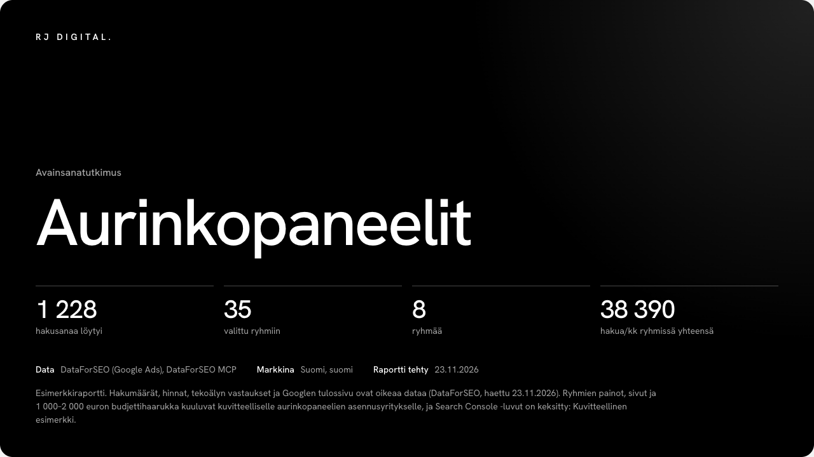

## 2. Aihekartta

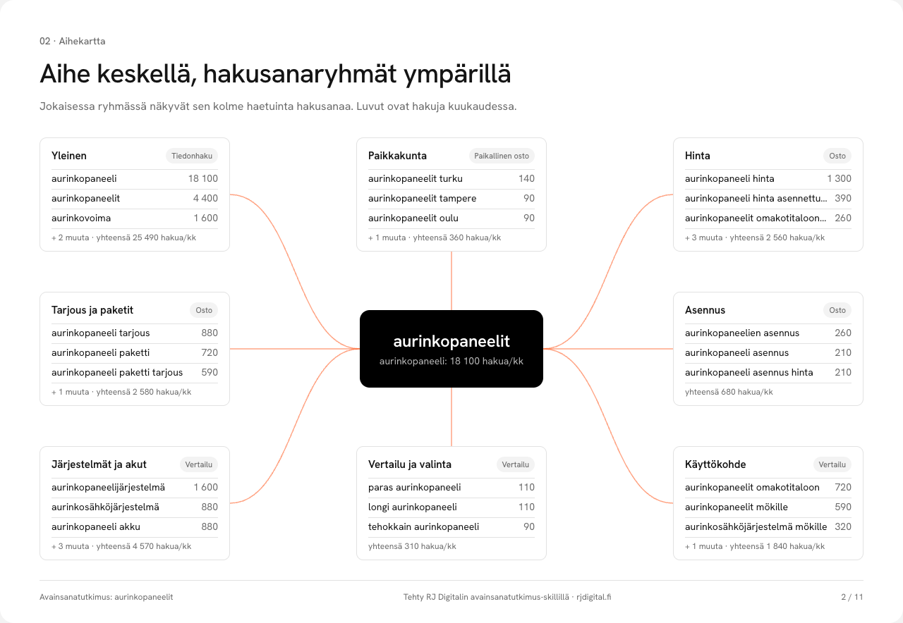

## 3. Hakusanat ryhmittäin

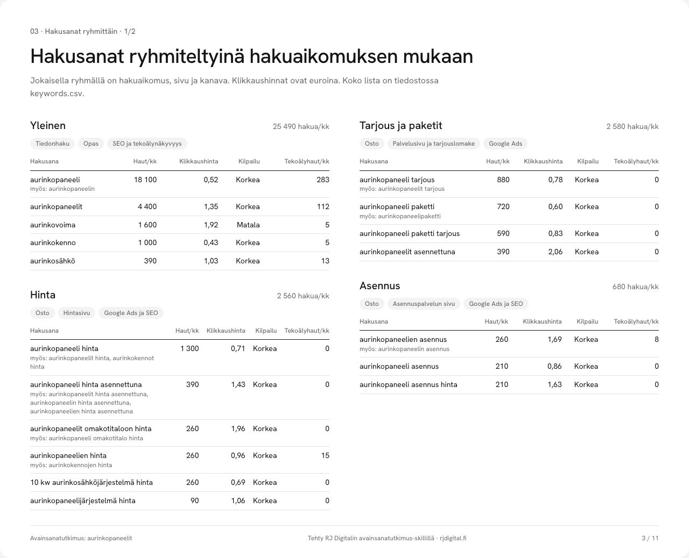

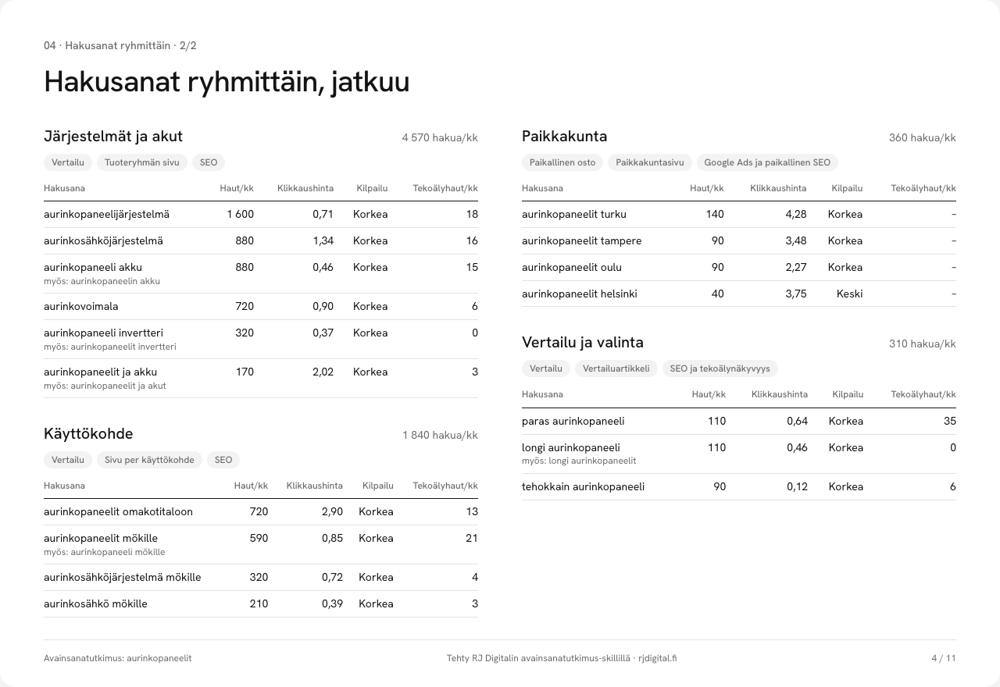

## 4. Kausivaihtelu

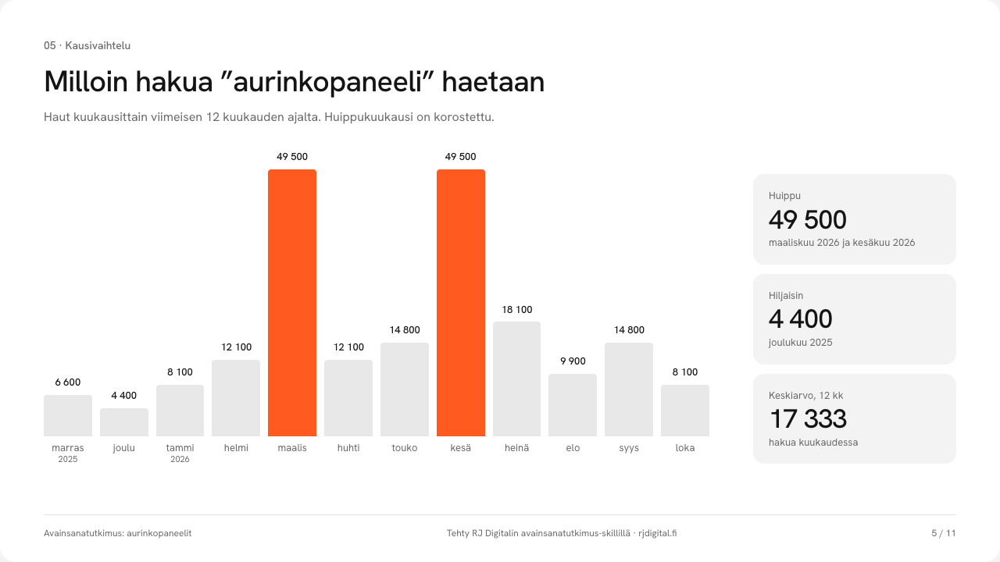

## 5. Budjetin jako

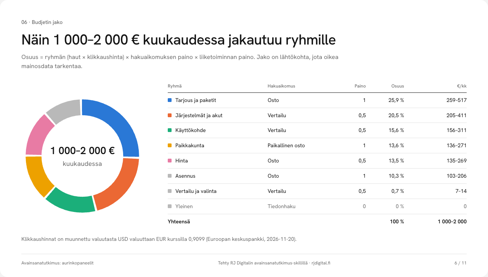

## 6. Tekoälyn vastaukset

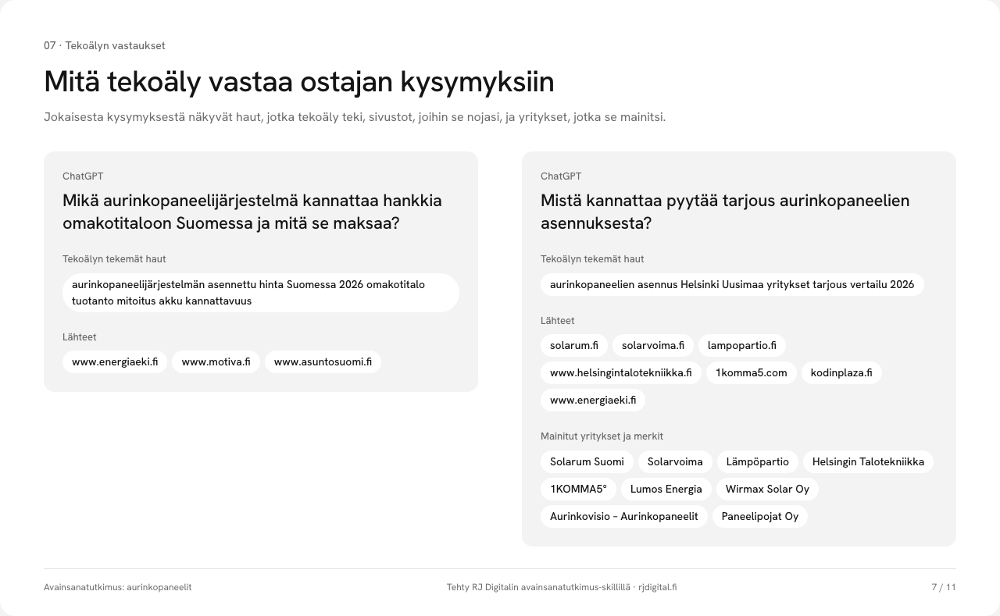

## 7. Googlen tulossivu

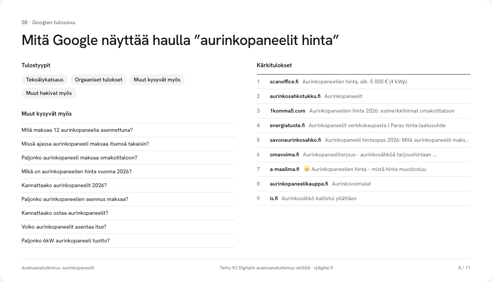

## 8. Oma sivusto hakutuloksissa

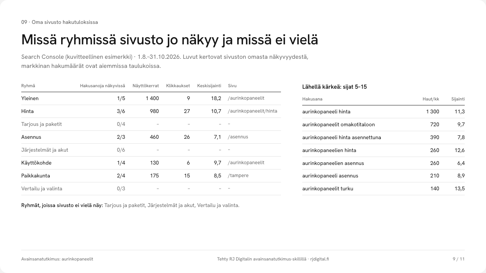

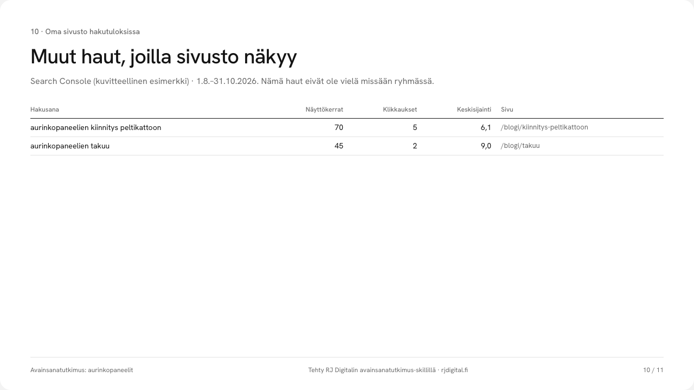

## 9. Ryhmittelemättömät hakusanat

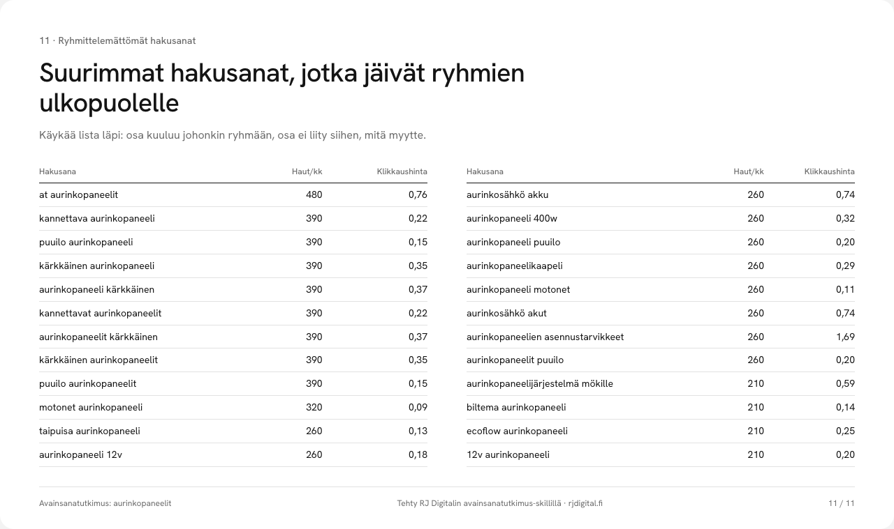
