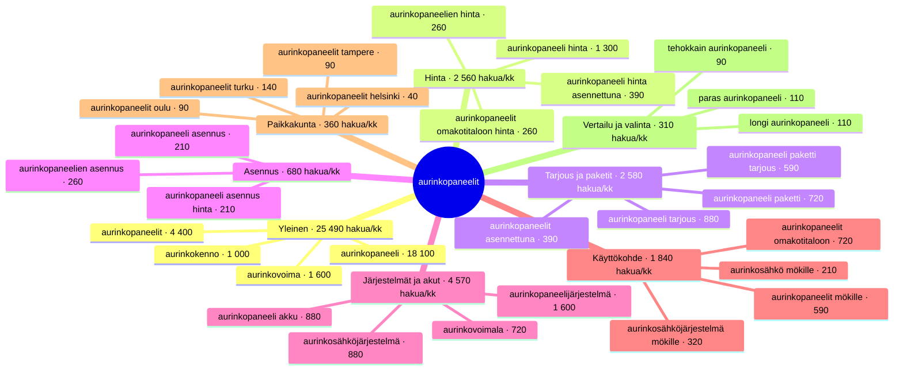

> Esimerkkiraportti. Hakumäärät, hinnat, tekoälyn vastaukset ja Googlen tulossivu ovat oikeaa dataa (DataForSEO, haettu 23.11.2026). Ryhmien painot, sivut ja 1 000 dollarin budjetti kuuluvat kuvitteelliselle aurinkopaneelien asennusyritykselle, ja osion "Oma sivusto hakutuloksissa" Search Console -luvut on keksitty: **Kuvitteellinen esimerkki.**

# Avainsanatutkimus: aurinkopaneelit

- Data: DataForSEO (Google Ads), DataForSEO MCP
- Markkina: Suomi, suomi
- Raportti tehty: 2026-11-23
- 1 228 hakusanaa löytyi, 35 valittu ryhmiin

## Aihekartta

## Hakusanat ryhmittäin

### Yleinen · 25 490 hakua/kk

Hakuaikomus: Tiedonhaku · Sivu: Opas · Kanava: SEO ja tekoälynäkyvyys

| Hakusana | Haut/kk | Klikkaushinta | Sivun yläosan hinta | Kilpailu | Tekoälyhaut/kk |
| --- | ---: | ---: | ---: | ---: | ---: |
| aurinkopaneeli (myös: aurinkopaneelin) | 18 100 | 0,57 USD | 0,26 USD – 1,52 USD | HIGH | 283 |
| aurinkopaneelit | 4 400 | 1,48 USD | 0,68 USD – 2,65 USD | HIGH | 112 |
| aurinkovoima | 1 600 | 2,11 USD | 0,78 USD – 4,48 USD | LOW | 5 |
| aurinkokenno | 1 000 | 0,47 USD | 0,16 USD – 1,49 USD | HIGH | 5 |
| aurinkosähkö | 390 | 1,13 USD | 0,64 USD – 2,47 USD | HIGH | 13 |

### Hinta · 2 560 hakua/kk

Hakuaikomus: Osto · Sivu: Hintasivu · Kanava: Google Ads ja SEO

| Hakusana | Haut/kk | Klikkaushinta | Sivun yläosan hinta | Kilpailu | Tekoälyhaut/kk |
| --- | ---: | ---: | ---: | ---: | ---: |
| aurinkopaneeli hinta (myös: aurinkopaneelit hinta, aurinkokennot hinta) | 1 300 | 0,78 USD | 0,33 USD – 1,42 USD | HIGH | 0 |
| aurinkopaneeli hinta asennettuna (myös: aurinkopaneelit hinta asennettuna, aurinkopaneelin hinta asennettuna, aurinkopaneelien hinta asennettuna) | 390 | 1,57 USD | 0,44 USD – 1,66 USD | HIGH | 0 |
| aurinkopaneelit omakotitaloon hinta (myös: aurinkopaneeli omakotitalo hinta) | 260 | 2,15 USD | 0,54 USD – 2,11 USD | HIGH | 0 |
| aurinkopaneelien hinta (myös: aurinkokennojen hinta) | 260 | 1,06 USD | 0,35 USD – 1,41 USD | HIGH | 15 |
| 10 kw aurinkosähköjärjestelmä hinta | 260 | 0,76 USD | 0,26 USD – 1,32 USD | HIGH | 0 |
| aurinkopaneelijärjestelmä hinta | 90 | 1,16 USD | 0,38 USD – 1,66 USD | HIGH | 0 |

### Tarjous ja paketit · 2 580 hakua/kk

Hakuaikomus: Osto · Sivu: Palvelusivu ja tarjouslomake · Kanava: Google Ads

| Hakusana | Haut/kk | Klikkaushinta | Sivun yläosan hinta | Kilpailu | Tekoälyhaut/kk |
| --- | ---: | ---: | ---: | ---: | ---: |
| aurinkopaneeli tarjous (myös: aurinkopaneelit tarjous) | 880 | 0,86 USD | 0,65 USD – 2,17 USD | HIGH | 0 |
| aurinkopaneeli paketti (myös: aurinkopaneelipaketti) | 720 | 0,66 USD | 0,34 USD – 1,61 USD | HIGH | 0 |
| aurinkopaneeli paketti tarjous | 590 | 0,91 USD | 0,48 USD – 1,70 USD | HIGH | 0 |
| aurinkopaneelit asennettuna | 390 | 2,26 USD | 0,74 USD – 2,77 USD | HIGH | 0 |

### Asennus · 680 hakua/kk

Hakuaikomus: Osto · Sivu: Asennuspalvelun sivu · Kanava: Google Ads ja SEO

| Hakusana | Haut/kk | Klikkaushinta | Sivun yläosan hinta | Kilpailu | Tekoälyhaut/kk |
| --- | ---: | ---: | ---: | ---: | ---: |
| aurinkopaneelien asennus (myös: aurinkopaneelin asennus) | 260 | 1,86 USD | 0,74 USD – 2,36 USD | HIGH | 8 |
| aurinkopaneeli asennus | 210 | 0,94 USD | 0,60 USD – 2,44 USD | HIGH | 0 |
| aurinkopaneeli asennus hinta | 210 | 1,79 USD | 0,49 USD – 1,78 USD | HIGH | 0 |

### Järjestelmät ja akut · 4 570 hakua/kk

Hakuaikomus: Vertailu · Sivu: Tuoteryhmän sivu · Kanava: SEO

| Hakusana | Haut/kk | Klikkaushinta | Sivun yläosan hinta | Kilpailu | Tekoälyhaut/kk |
| --- | ---: | ---: | ---: | ---: | ---: |
| aurinkopaneelijärjestelmä | 1 600 | 0,78 USD | 0,47 USD – 1,74 USD | HIGH | 18 |
| aurinkosähköjärjestelmä | 880 | 1,47 USD | 0,69 USD – 2,45 USD | HIGH | 16 |
| aurinkopaneeli akku (myös: aurinkopaneelin akku) | 880 | 0,51 USD | 0,27 USD – 1,14 USD | HIGH | 15 |
| aurinkovoimala | 720 | 0,99 USD | 0,76 USD – 2,31 USD | HIGH | 6 |
| aurinkopaneeli invertteri (myös: aurinkopaneelit invertteri) | 320 | 0,41 USD | 0,26 USD – 1,22 USD | HIGH | 0 |
| aurinkopaneelit ja akku (myös: aurinkopaneelit ja akut) | 170 | 2,22 USD | 0,73 USD – 2,76 USD | HIGH | 3 |

### Käyttökohde · 1 840 hakua/kk

Hakuaikomus: Vertailu · Sivu: Sivu per käyttökohde · Kanava: SEO

| Hakusana | Haut/kk | Klikkaushinta | Sivun yläosan hinta | Kilpailu | Tekoälyhaut/kk |
| --- | ---: | ---: | ---: | ---: | ---: |
| aurinkopaneelit omakotitaloon | 720 | 3,19 USD | 0,76 USD – 3,54 USD | HIGH | 13 |
| aurinkopaneelit mökille (myös: aurinkopaneeli mökille) | 590 | 0,93 USD | 0,33 USD – 1,63 USD | HIGH | 21 |
| aurinkosähköjärjestelmä mökille | 320 | 0,79 USD | 0,08 USD – 1,48 USD | HIGH | 4 |
| aurinkosähkö mökille | 210 | 0,43 USD | 0,05 USD – 1,10 USD | HIGH | 3 |

### Paikkakunta · 360 hakua/kk

Hakuaikomus: Paikallinen osto · Sivu: Paikkakuntasivu · Kanava: Google Ads ja paikallinen SEO

| Hakusana | Haut/kk | Klikkaushinta | Sivun yläosan hinta | Kilpailu | Tekoälyhaut/kk |
| --- | ---: | ---: | ---: | ---: | ---: |
| aurinkopaneelit turku | 140 | 4,70 USD | 1,36 USD – 4,97 USD | HIGH | – |
| aurinkopaneelit tampere | 90 | 3,82 USD | 1,34 USD – 3,81 USD | HIGH | – |
| aurinkopaneelit oulu | 90 | 2,49 USD | 0,75 USD – 2,60 USD | HIGH | – |
| aurinkopaneelit helsinki | 40 | 4,12 USD | 1,92 USD – 4,39 USD | MEDIUM | – |

### Vertailu ja valinta · 310 hakua/kk

Hakuaikomus: Vertailu · Sivu: Vertailuartikkeli · Kanava: SEO ja tekoälynäkyvyys

| Hakusana | Haut/kk | Klikkaushinta | Sivun yläosan hinta | Kilpailu | Tekoälyhaut/kk |
| --- | ---: | ---: | ---: | ---: | ---: |
| paras aurinkopaneeli | 110 | 0,70 USD | 0,24 USD – 1,39 USD | HIGH | 35 |
| longi aurinkopaneeli (myös: longi aurinkopaneelit) | 110 | 0,51 USD | 0,38 USD – 2,03 USD | HIGH | 0 |
| tehokkain aurinkopaneeli | 90 | 0,13 USD | 0,14 USD – 0,84 USD | HIGH | 6 |

## Kausivaihtelu: aurinkopaneeli

| Kuukausi | Haut/kk | |
| --- | ---: | --- |
| 2025-11 | 6 600 | ███ |
| 2025-12 | 4 400 | ██ |
| 2026-01 | 8 100 | ███ |
| 2026-02 | 12 100 | █████ |
| 2026-03 | 49 500 | ████████████████████ huippu |
| 2026-04 | 12 100 | █████ |
| 2026-05 | 14 800 | ██████ |
| 2026-06 | 49 500 | ████████████████████ huippu |
| 2026-07 | 18 100 | ███████ |
| 2026-08 | 9 900 | ████ |
| 2026-09 | 14 800 | ██████ |
| 2026-10 | 8 100 | ███ |

## Budjetin jako

| Ryhmä | Hakuaikomus | Paino | Osuus | USD/kk |
| --- | --- | ---: | ---: | ---: |
| Tarjous ja paketit | Osto | 1 | 25,9 % | 259 |
| Järjestelmät ja akut | Vertailu | 0,5 | 20,5 % | 205 |
| Käyttökohde | Vertailu | 0,5 | 15,6 % | 156 |
| Paikkakunta | Paikallinen osto | 1 | 13,6 % | 136 |
| Hinta | Osto | 0,5 | 13,5 % | 135 |
| Asennus | Osto | 1 | 10,3 % | 103 |
| Vertailu ja valinta | Vertailu | 0,5 | 0,7 % | 7 |
| Yleinen | Tiedonhaku | 0 | 0 % | 0 |
| **Yhteensä** | | | 100 % | **1 000** |

Osuus = ryhmän (haut × klikkaushinta) × hakuaikomuksen paino × liiketoiminnan paino. Jako on lähtökohta, jota oikea mainosdata tarkentaa.

## Tekoälyn vastaukset

### Mikä aurinkopaneelijärjestelmä kannattaa hankkia omakotitaloon Suomessa ja mitä se maksaa? (ChatGPT)

- Tekoälyn tekemät haut: aurinkopaneelijärjestelmän asennettu hinta Suomessa 2026 omakotitalo tuotanto mitoitus akku kannattavuus
- Lähteet: www.energiaeki.fi, www.motiva.fi, www.asuntosuomi.fi

### Mistä kannattaa pyytää tarjous aurinkopaneelien asennuksesta? (ChatGPT)

- Tekoälyn tekemät haut: aurinkopaneelien asennus Helsinki Uusimaa yritykset tarjous vertailu 2026
- Lähteet: solarum.fi, solarvoima.fi, lampopartio.fi, www.helsingintalotekniikka.fi, 1komma5.com, kodinplaza.fi, www.energiaeki.fi
- Mainitut yritykset ja merkit: Solarum Suomi, Solarvoima, Lämpöpartio, Helsingin Talotekniikka, 1KOMMA5°, Lumos Energia, Wirmax Solar Oy, Aurinkovisio – Aurinkopaneelit, Paneelipojat Oy

## Googlen tulossivu

### aurinkopaneelit hinta

- Tulostyypit: ai_overview, organic, people_also_ask, people_also_search
- Muut kysyvät myös:
  - Mitä maksaa 12 aurinkopaneelia asennettuna?
  - Missä ajassa aurinkopaneeli maksaa itsensä takaisin?
  - Paljonko aurinkopaneeli maksaa omakotitaloon?
  - Mikä on aurinkopaneelien hinta vuonna 2026?
  - Kannattaako aurinkopaneelit 2026?
  - Paljonko aurinkopaneelien asennus maksaa?
  - Kannattaako ostaa aurinkopaneelit?
  - Voiko aurinkopaneelit asentaa itse?
  - Paljonko 6kW aurinkopaneeli tuotto?
- Kärkitulokset:
  - 1. scanoffice.fi: Aurinkopaneelien hinta, alk. 5 000 € (4 kWp)
  - 2. aurinkosahkotukku.fi: Aurinkopaneelit
  - 3. 1komma5.com: Aurinkopaneelien hinta 2026: esimerkkihinnat omakotitaloon
  - 4. energiatuote.fi: Aurinkopaneelit verkkokaupasta l Paras hinta-laatusuhde
  - 5. savonaurinkosahko.fi: Aurinkopaneeli hintaopas 2026: Mitä aurinkopaneelit maksaa?
  - 6. omavoima.fi: Aurinkopaneelitarjous - aurinkosähköä tarjoushintaan ...
  - 7. a-maailma.fi: ☀️ Aurinkopaneelien hinta – mistä hinta muodostuu
  - 8. aurinkopaneelikauppa.fi: Aurinkovoimalat
  - 9. is.fi: Aurinkosähkö kallistui yllättäen

## Oma sivusto hakutuloksissa

Luvut kertovat sivuston omasta näkyvyydestä. Markkinan hakumäärät ovat yllä olevissa taulukoissa.

### Search Console (kuvitteellinen esimerkki) · 1.8.–31.10.2026

| Ryhmä | Hakusanoja näkyvissä | Näyttökerrat | Klikkaukset | Keskisijainti | Sivu |
| --- | ---: | ---: | ---: | ---: | --- |
| Yleinen | 1/5 | 1 400 | 9 | 18,2 | /aurinkopaneelit |
| Hinta | 3/6 | 980 | 27 | 10,7 | /aurinkopaneelit/hinta |
| Tarjous ja paketit | 0/4 | – | – | – | – |
| Asennus | 2/3 | 460 | 26 | 7,1 | /asennus |
| Järjestelmät ja akut | 0/6 | – | – | – | – |
| Käyttökohde | 1/4 | 130 | 6 | 9,7 | /aurinkopaneelit |
| Paikkakunta | 2/4 | 175 | 15 | 8,5 | /tampere |
| Vertailu ja valinta | 0/3 | – | – | – | – |

Ryhmät, joissa sivusto ei vielä näy: Tarjous ja paketit, Järjestelmät ja akut, Vertailu ja valinta.

#### Lähellä kärkeä: sijat 5–15

| Hakusana | Ryhmä | Haut/kk | Näyttökerrat | Keskisijainti | Sivu |
| --- | --- | ---: | ---: | ---: | --- |
| aurinkopaneeli hinta | Hinta | 1 300 | 620 | 11,3 | /aurinkopaneelit/hinta |
| aurinkopaneelit omakotitaloon | Käyttökohde | 720 | 130 | 9,7 | /aurinkopaneelit |
| aurinkopaneeli hinta asennettuna | Hinta | 390 | 210 | 7,8 | /aurinkopaneelit/hinta |
| aurinkopaneelien hinta | Hinta | 260 | 150 | 12,6 | /aurinkopaneelit/hinta |
| aurinkopaneelien asennus | Asennus | 260 | 340 | 6,4 | /asennus |
| aurinkopaneeli asennus | Asennus | 210 | 120 | 8,9 | /asennus |
| aurinkopaneelit turku | Paikkakunta | 140 | 80 | 13,5 | /turku |

#### Muut haut, joilla sivusto näkyy

| Hakusana | Näyttökerrat | Klikkaukset | Keskisijainti | Sivu |
| --- | ---: | ---: | ---: | --- |
| aurinkopaneelien kiinnitys peltikattoon | 70 | 5 | 6,1 | /blogi/kiinnitys-peltikattoon |
| aurinkopaneelien takuu | 45 | 2 | 9,0 | /blogi/takuu |

## Suurimmat ryhmittelemättömät hakusanat

| Hakusana | Haut/kk | Klikkaushinta |
| --- | ---: | ---: |
| at aurinkopaneelit | 480 | 0,84 USD |
| kannettava aurinkopaneeli | 390 | 0,24 USD |
| puuilo aurinkopaneeli | 390 | 0,16 USD |
| kärkkäinen aurinkopaneeli | 390 | 0,38 USD |
| aurinkopaneeli kärkkäinen | 390 | 0,41 USD |
| kannettavat aurinkopaneelit | 390 | 0,24 USD |
| aurinkopaneelit kärkkäinen | 390 | 0,41 USD |
| kärkkäinen aurinkopaneelit | 390 | 0,38 USD |
| puuilo aurinkopaneelit | 390 | 0,16 USD |
| motonet aurinkopaneeli | 320 | 0,10 USD |
| taipuisa aurinkopaneeli | 260 | 0,14 USD |
| aurinkopaneeli 12v | 260 | 0,20 USD |
| aurinkosähkö akku | 260 | 0,81 USD |
| aurinkopaneeli 400w | 260 | 0,35 USD |
| aurinkopaneeli puuilo | 260 | 0,22 USD |
| aurinkopaneelikaapeli | 260 | 0,32 USD |
| aurinkopaneeli motonet | 260 | 0,12 USD |
| aurinkosähkö akut | 260 | 0,81 USD |
| aurinkopaneelien asennustarvikkeet | 260 | 1,86 USD |
| aurinkopaneelit puuilo | 260 | 0,22 USD |
| aurinkopaneelijärjestelmä mökille | 210 | 0,65 USD |
| biltema aurinkopaneeli | 210 | 0,15 USD |
| ecoflow aurinkopaneeli | 210 | 0,27 USD |
| 12v aurinkopaneeli | 210 | 0,22 USD |
| 400w aurinkopaneeli | 210 | 0,19 USD |
