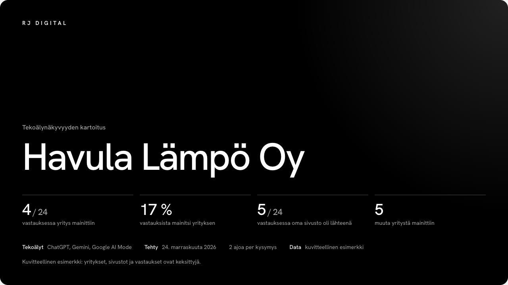
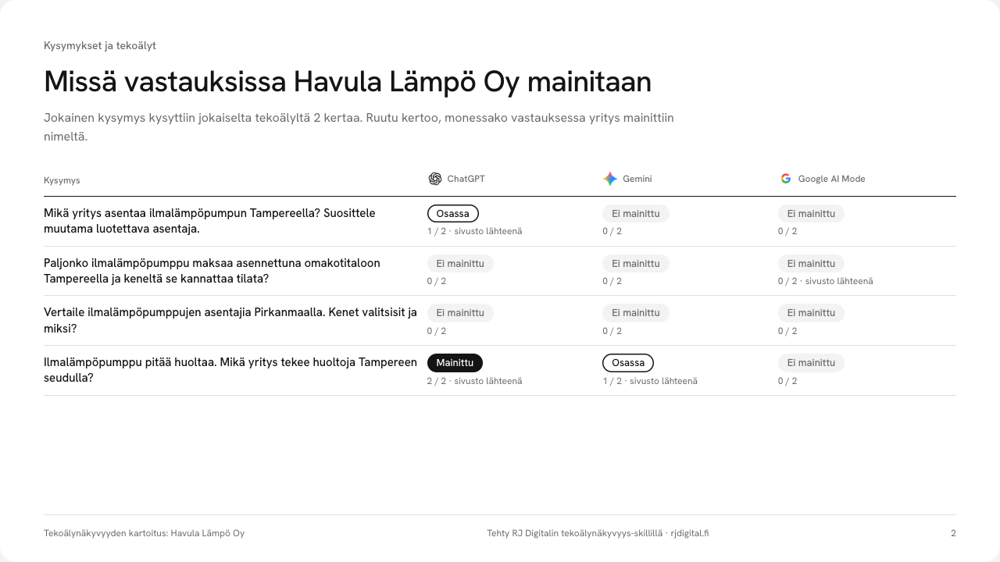
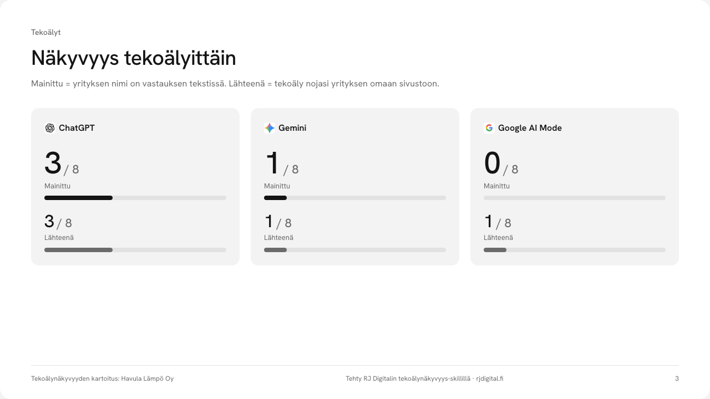
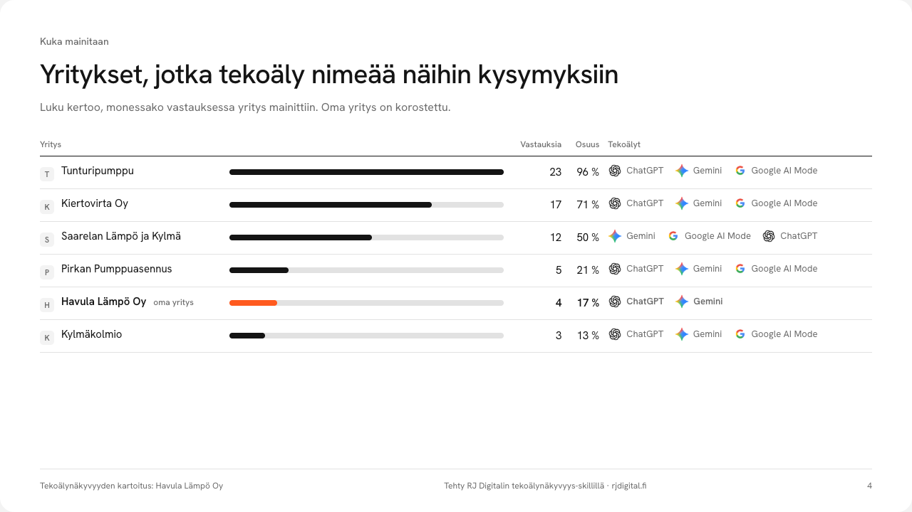
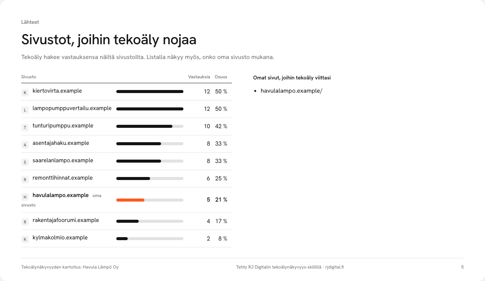
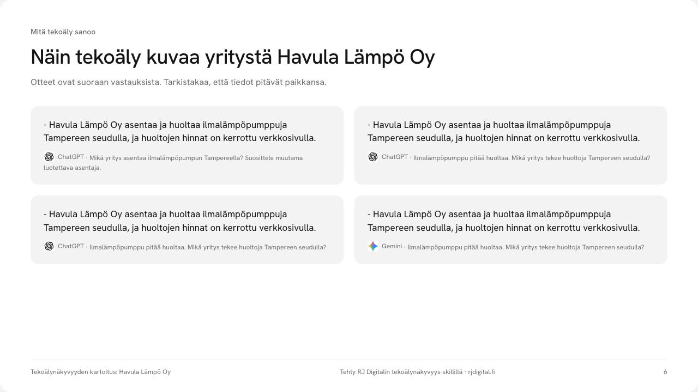
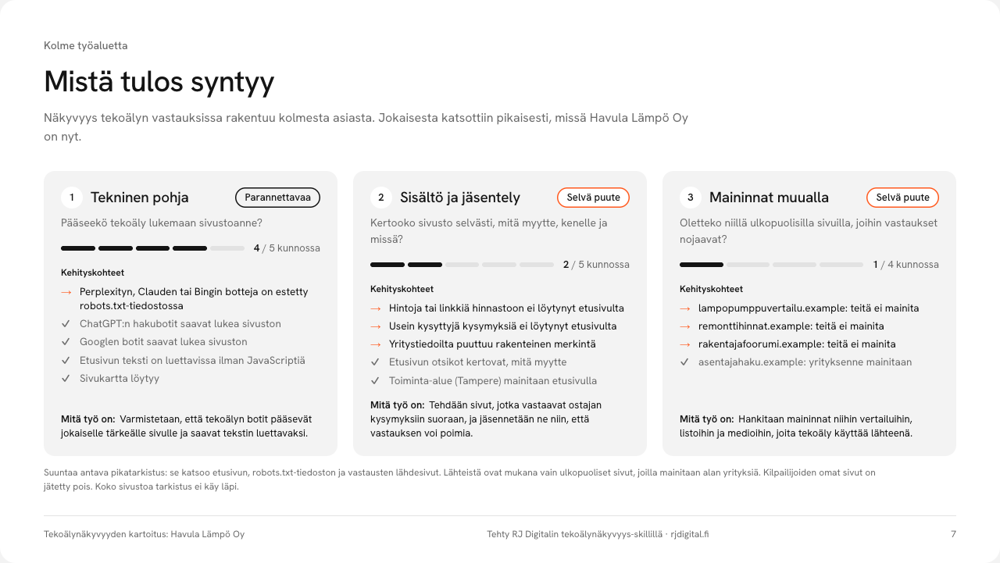
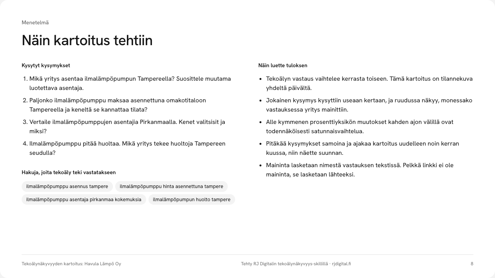

# Esimerkkiraportti: ilmalämpöpumput

Tältä tekoälynäkyvyys-skillin raportti näyttää. Raportti on yksi HTML-tiedosto, joka avautuu selaimessa ja tulostuu PDF:ksi dia kerrallaan. Alla ovat sen diat kuvina.

**Kuvitteellinen esimerkki.** Yritykset, sivustot ja tekoälyn vastaukset ovat keksittyjä. Esimerkki näyttää raportin rakenteen: neljä kysymystä kysyttiin kolmelta tekoälyltä kahteen kertaan, eli vastauksia on 24.

Tiedostot:

- [report.html](report.html): raportti dioina. Ladatkaa tiedosto ja avatkaa se selaimessa.
- [report.md](report.md): sama raportti tekstinä.
- [brief.json](brief.json): yritys, kysymykset, tekoälyt ja vahvistetut kilpailijat.
- [answers.json](answers.json): vastaukset, joista raportti on laskettu.
- [result.json](result.json): analyysin tulos.
- [checks.json](checks.json): sivuston ja lähdesivujen pikatarkistus, tässä keksityin tuloksin.

## 1. Kansi

## 2. Kysymykset ja tekoälyt

## 3. Näkyvyys tekoälyittäin

## 4. Keitä tekoäly nimeää

## 5. Lähteet

## 6. Mitä yrityksestä sanottiin

## 7. Mistä tulos syntyy

## 8. Näin kartoitus tehtiin

